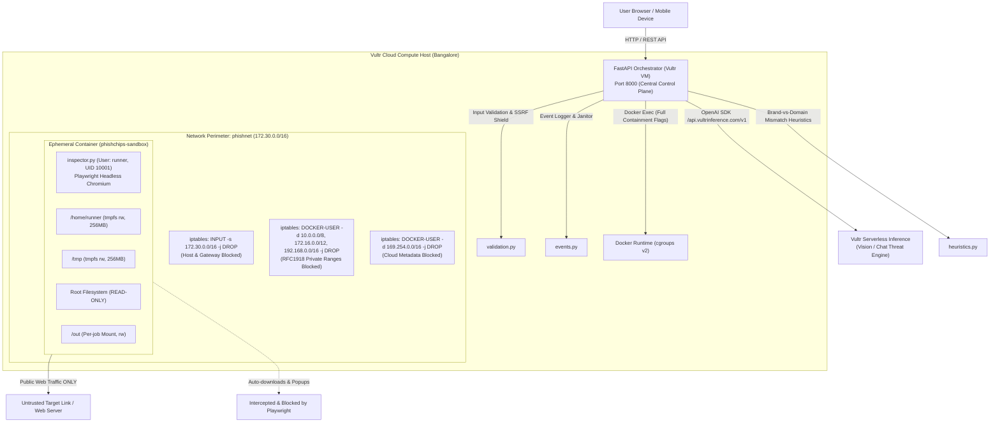

# 🐟🍟 Phish&Chips

> **Tagline:** Fresh phish, fried in a sandbox.  
> **Event:** Vultr Agent Rush Hackathon on lablab.ai  
> **Track:** **01 · Blast Radius Zero**  
> **Live Deployment:** [http://139.84.159.12:8000](http://139.84.159.12:8000)  

---

## 1. Executive Summary

**Phish&Chips** is an ephemeral detonation and threat analysis platform that allows anyone to inspect suspicious links (fake KYC updates, UPI refund scams, banking portals, malicious file delivery) **without ever opening the link on their own device or touching the host operating system**.

Every scan triggers a locked-down, unprivileged Docker container (`phishchips-sandbox`) launched on a hardened **Vultr Cloud Compute VM** (Bangalore, 4 vCPU, 8 GB RAM). A sandboxed headless Chromium browser detonates the target URL, intercepts redirect chains, captures visual proof, blocks automatic file downloads, and records all DOM inputs. 

The collected telemetry and screenshots are evaluated using a vision-capable model on **Vultr Serverless Inference** combined with a brand impersonation and heuristic rules engine. Once analysis completes, the container is **immediately destroyed** and the user is presented with a **Verdict Card** (Safe / Suspicious / Scam), a screenshot timeline, and a verifiable **Containment Log** concluding with:

```text
🍟 Phish fried. Sandbox destroyed.
```

---

## 2. Architecture & Blast Radius Zero Perimeter



---

## 3. The 4 Non-Negotiable Containment Guarantees

In accordance with Track 01 criteria (**Blast Radius Zero**), containment is the product:

| Guarantee | Technical Implementation & Boundary Proof |
|---|---|
| **1. Process Isolation** | Execution occurs strictly inside throwaway Docker containers under an unprivileged user (`runner`, UID 10001). Linux capabilities are completely stripped via `--cap-drop=ALL` and privilege escalation is prevented with `--security-opt=no-new-privileges`. Root filesystem is `--read-only`. |
| **2. Secret Hygiene** | Zero API keys, SSH keys, or cloud credentials ever enter the sandbox container. Only `TARGET_URL` and non-sensitive flags are passed via environment variables. The Docker socket is never mounted. |
| **3. Hard Resource Limits** | Hard Linux cgroup limits enforce `--cpus=1`, `--memory=1g`, `--memory-swap=1g`, and `--pids-limit=256`. The FastAPI orchestrator enforces a hard 45-second wall-clock kill switch (`docker kill` & `docker rm -f`). |
| **4. Lifecycle Discipline** | Every sandbox container is destroyed immediately after telemetry collection (`--rm` + automated cleanup in finally blocks). A background janitor purges any orphan containers and retains job artifacts strictly for the retention period. |

---

## 4. Pattern B: Sandboxed Browser Use with Human Approval

Phish&Chips implements the hackathon's required **Pattern B** workflow:

1. **Pass 1 (Passive Reconnaissance):** The sandbox opens the target link, observes redirects, captures visual screenshots (`shot1.png`, `shot2.png`), inspects the DOM, and checks for credential forms.
2. **Human Approval Gate:** If login, password, OTP, or payment card fields are detected, the orchestrator pauses and transitions job status to `awaiting_approval`. The UI presents the user with an interactive decision banner:
   > *"The sandboxed page asks for sensitive credentials (Password / OTP / Card). Allow the sandboxed browser to enter fake dummy canary values and submit to inspect post-submission exfiltration behavior?"*
3. **Pass 2 (Simulated Canary Submission):**
   - **User approves:** A second ephemeral container launches with `SUBMIT_PASS=1`. The browser populates fake dummy values (`test_canary_user@example.com`, `FakePassword123!`, `123456`) and clicks submit to observe where the data exfiltrates. Post-submit screenshots and redirect URLs are captured.
   - **User denies:** The orchestrator skips submission and proceeds directly to threat synthesis using Pass 1 evidence.

---

## 5. Verifiable Containment Verification

An automated verification test script ([scripts/verify_containment.sh](file:///root/phish-n-chips/scripts/verify_containment.sh)) proves from inside an active container that isolation holds:

```bash
# Execute containment verification suite on the host VM
bash scripts/verify_containment.sh
```

**Verification Output:**
```text
==========================================================
    PHISH&CHIPS: CONTAINMENT PERIMETER VERIFICATION       
==========================================================
Starting ephemeral verification container in phishnet...
  Testing Public Internet (Cloudflare 1.1.1.1) (https://1.1.1.1) ...  [PASS] REACHABLE (HTTP 301)
  Testing Public Internet (Example.com) (https://example.com) ...      [PASS] REACHABLE (HTTP 200)
  Testing Host Bridge Gateway (172.30.0.1:8000) ...                   [PASS] BLOCKED (Code: 28)
  Testing Host Public IP (139.84.159.12:8000) ...                     [PASS] BLOCKED (Code: 28)
  Testing Cloud Metadata Service (169.254.169.254) ...                [PASS] BLOCKED (Code: 28)
  Testing Private Subnet 10.0.0.1 ...                                 [PASS] BLOCKED (Code: 28)
  Testing Private Subnet 192.168.1.1 ...                              [PASS] BLOCKED (Code: 28)
----------------------------------------------------------
🎉 ALL CONTAINMENT CHECKS PASSED. Blast Radius Zero verified!
```

---

## 6. Repository Layout

```text
phish-and-chips/
├── README.md                 # Product documentation, architecture, and containment proofs
├── PROJECT_BRIEF.md          # Official hackathon brief & rules
├── .env.example              # Environment variables template
├── .gitignore                # Secret & artifact exclusion rules
├── deploy.sh                 # 1-click deployment & rebuild script
├── backend/
│   ├── main.py               # FastAPI orchestrator, REST routes, static mounting
│   ├── scanner.py            # Docker lifecycle, cgroups limits, janitor & approval gate
│   ├── analyzer.py           # Vultr Serverless Inference integration + fallback logic
│   ├── heuristics.py         # Brand-vs-domain rules & credential harvesting detection
│   ├── events.py             # Structured timestamped containment event logging
│   ├── validation.py         # URL validation, SSRF blocking & sliding-window rate limiter
│   └── requirements.txt      # Python backend dependencies
├── sandbox/
│   ├── Dockerfile            # Python 3.12 + Playwright Chromium sandbox image
│   ├── inspector.py          # Non-root browser automation & telemetry extraction
│   └── bank_login.html       # Self-contained demo asset
├── frontend/
│   ├── index.html            # Monospace dark-mode dashboard with live stepper & log
│   ├── app.js                # Detonation form handler, polling engine & approval modal
│   └── styles.css            # Cyber monospace styling
├── scripts/
│   ├── setup_network.sh      # Idempotent phishnet bridge & iptables containment setup
│   └── verify_containment.sh # Automated isolation proof script
├── demo/
│   └── fake-pages/           # Harmless fake phishing pages for video demonstration
└── deploy/
    └── phishchips.service    # systemd unit configuration for production runtime
```

---

## 7. Setup & Local Development

### Prerequisites
- Docker Engine & iptables
- Python 3.12+
- Vultr Cloud Compute VM (Ubuntu 24.04 LTS recommended)

### 1. Setup Isolated Network
```bash
sudo bash scripts/setup_network.sh
```

### 2. Build Sandbox Container
```bash
docker build -t phishchips-sandbox ./sandbox
```

### 3. Configure Environment
```bash
cp .env.example .env
# Edit .env and configure VULTR_INFERENCE_API_KEY
```

### 4. Run Backend
```bash
cd backend
python3 -m venv venv
source venv/bin/activate
pip install -r requirements.txt
uvicorn main:app --host 0.0.0.0 --port 8000
```

Open [http://localhost:8000](http://localhost:8000) in your browser.

---

## 8. Deployment to Vultr VM

The included `deploy.sh` script executes a 1-command sync, build, dependency installation, and systemd service reload over SSH:

```bash
./deploy.sh
```

---

## 9. License

Built for the **Vultr Agent Rush Hackathon** (November 2026).  
*Fresh phish, fried in a sandbox.* 🐟🍟
